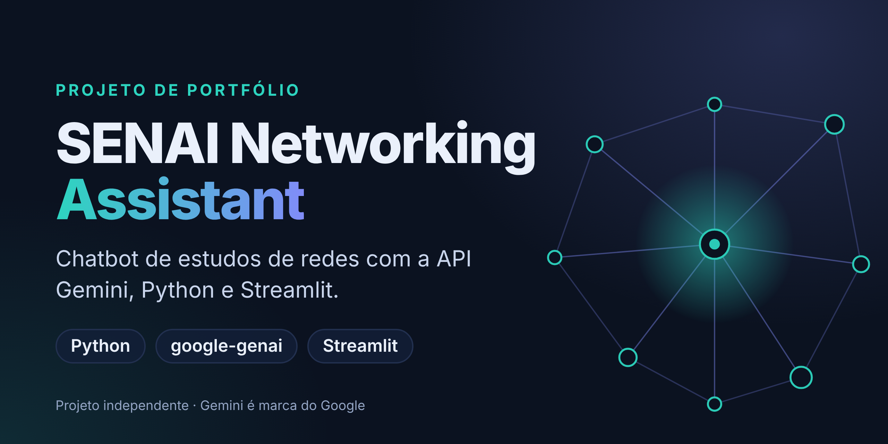
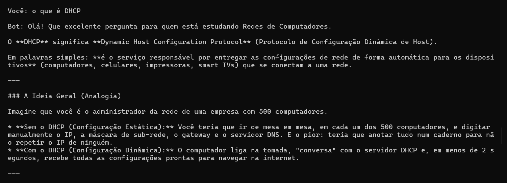
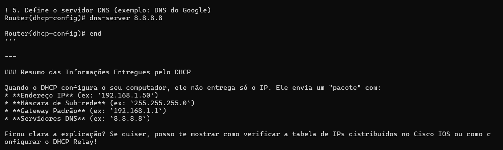
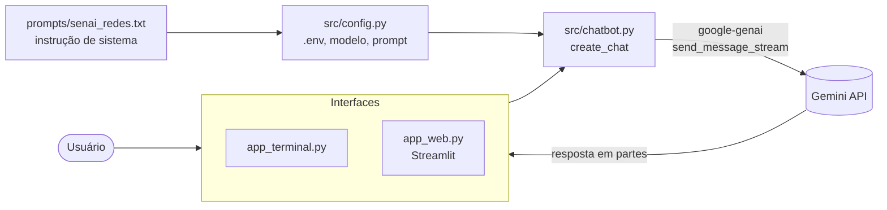

# SENAI Networking Assistant

Chatbot de estudos de redes de computadores feito com **Python**, **Gemini API** e **Streamlit**. Ele roda no terminal ou no navegador e foi configurado para explicar Cisco, Python e Linux de forma simples, em português.

> Projeto de estudo independente. Não é afiliado, patrocinado nem endossado pelo SENAI ou pelo Google. "Gemini" é marca do Google.



## Sobre o projeto

O SENAI Networking Assistant é um tutor de redes em formato de chat. Você pergunta, por exemplo, "o que é DHCP?" ou "como funciona uma VLAN?", e o modelo Gemini responde seguindo uma instrução de sistema que define o papel de instrutor, o idioma e o estilo das explicações.

### Objetivo

Praticar, em um projeto pequeno e completo, os pontos principais de uma integração com IA generativa:

- autenticar na API sem expor a chave;
- manter o histórico da conversa;
- dar um papel ao modelo com uma instrução de sistema;
- exibir a resposta em streaming;
- separar a lógica do chatbot das interfaces;
- documentar e testar a parte de configuração.

## Demonstração

O projeto tem duas interfaces para a mesma lógica:

| Interface | Comando | O que você vê |
|---|---|---|
| Terminal | `python app_terminal.py` | Banner com o nome e o modelo, prompt `Você:` e a resposta chegando aos poucos |
| Web (Streamlit) | `streamlit run app_web.py` | Página de chat com histórico, resposta em streaming e botão "Nova conversa" na barra lateral |

### Exemplo real no terminal

A pergunta "o que é DHCP" respondida pelo chatbot. São capturas reais; a resposta do modelo muda a cada execução.





No terminal, o texto aparece com as marcações de Markdown (`**negrito**`, `###`). A interface web exibe a resposta com `st.markdown`, que interpreta essas marcações.

## Funcionalidades

- Chat no terminal com resposta em streaming.
- Interface web com Streamlit: histórico na tela, resposta em streaming e botão para iniciar uma nova conversa.
- Memória durante a sessão: cada pergunta é enviada junto com as anteriores.
- Personalidade definida em arquivo de texto (`prompts/senai_redes.txt`), editável sem mexer no código.
- Modelo configurável pela variável `GEMINI_MODEL`.
- Mensagens de erro de configuração que apontam a causa provável (arquivo `.env` ausente, salvo como `.env.txt`, variável com nome errado etc.).
- Testes automatizados da camada de configuração.

## Tecnologias

| Tecnologia | Uso |
|---|---|
| Python 3.10+ | Linguagem do projeto |
| `google-genai` | SDK oficial do Google para a Gemini API |
| Streamlit | Interface web de chat |
| `python-dotenv` | Leitura das variáveis do arquivo `.env` |
| `pytest` | Testes automatizados |

## Arquitetura



Mais detalhes em [docs/ARCHITECTURE.md](docs/ARCHITECTURE.md).

## Como a integração com o Gemini funciona

O arquivo `src/chatbot.py` cria um único cliente da API e, a partir dele, uma conversa (`chat`) com a instrução de sistema carregada de `prompts/senai_redes.txt`:

```python
client = genai.Client(api_key=get_api_key())

chat = client.chats.create(
    model=MODEL,
    config=types.GenerateContentConfig(system_instruction=instruction),
)

for pedaco in chat.send_message_stream(pergunta):
    print(pedaco.text or "", end="", flush=True)
```

O objeto `chat` guarda o histórico em memória e o envia a cada nova pergunta. A API em si não guarda a conversa.

## Estrutura do projeto

```
.
├── app_terminal.py        # interface de terminal
├── app_web.py             # interface web (Streamlit)
├── requirements.txt       # dependências
├── .env.example           # modelo do arquivo de configuração
├── .gitignore
├── src/
│   ├── config.py          # chave, modelo, prompt e diagnóstico de erros
│   └── chatbot.py         # cliente e conversa com o Gemini
├── prompts/
│   └── senai_redes.txt    # instrução de sistema do chatbot
├── exemplos/              # passo a passo do mais simples ao completo
├── tests/
│   └── test_config.py
├── docs/
│   ├── ARCHITECTURE.md
│   ├── SECURITY.md
│   └── TUTORIAL.md
├── assets/
│   ├── diagrams/
│   ├── screenshots/
│   └── social/
└── CHANGELOG.md
```

## Pré-requisitos

- Python 3.10 ou superior (os testes foram executados em Python 3.13).
- Uma chave da Gemini API, gratuita para começar: [Google AI Studio](https://aistudio.google.com/apikey).

## Instalação

```bash
git clone https://github.com/SEU-USUARIO/senai-networking-assistant.git
cd senai-networking-assistant

python -m venv .venv
# Windows:    .venv\Scripts\activate
# Linux/Mac:  source .venv/bin/activate

pip install -r requirements.txt
```

## Configuração das variáveis de ambiente

1. Copie o arquivo de exemplo:

   ```bash
   # Windows:    copy .env.example .env
   # Linux/Mac:  cp .env.example .env
   ```

2. Abra o `.env` e coloque sua chave, sem aspas e sem espaços:

   ```
   GEMINI_API_KEY=sua_chave_aqui
   GEMINI_MODEL=gemini-3.5-flash
   ```

| Variável | Obrigatória | Descrição |
|---|---|---|
| `GEMINI_API_KEY` | Sim | Chave da Gemini API |
| `GEMINI_MODEL` | Não | Modelo usado. Padrão: `gemini-3.5-flash`. Veja a [lista atual de modelos](https://ai.google.dev/gemini-api/docs/models) |

O arquivo `.env` está no `.gitignore` e **nunca deve ser enviado ao GitHub**. Veja [docs/SECURITY.md](docs/SECURITY.md).

## Como executar

```bash
python app_terminal.py       # terminal
streamlit run app_web.py     # navegador
```

No terminal, digite `sair` para encerrar.

## Exemplos de utilização

Perguntas para testar:

- "O que é DHCP e como ele funciona?"
- "Explique VLAN com um exemplo de configuração em um switch Cisco."
- "Qual a diferença entre NAT estático e dinâmico?"
- "Me ajude a resolver: quantos hosts cabem em uma rede /26?"

Para testar a memória: diga "Meu nome é Arthur" e, em seguida, "Qual é o meu nome?".

## Tratamento de erros

- Falta de configuração: o programa explica o que está errado (por exemplo, o `.env` não existe, foi salvo como `.env.txt` ou a variável tem outro nome) e como corrigir.
- Falha na chamada à API (rede, chave inválida, limite de uso): o erro é mostrado na tela e a conversa continua aberta.

## Testes

```bash
python -m pytest
```

Os testes cobrem a camada de configuração (leitura da chave, mensagens de diagnóstico e prompt). Eles não chamam a API e, por isso, não gastam cota. **Não há testes automatizados da resposta do Gemini nem da interface Streamlit.**

## Limites de uso e custos

Os limites da Gemini API são aplicados por projeto (não por chave) e dependem do nível da conta e do modelo. Ao exceder um limite, a API retorna erro (por exemplo, 429). Os valores atuais para o seu projeto ficam no [Google AI Studio](https://aistudio.google.com/rate-limit). Consulte também a [documentação de limites](https://ai.google.dev/gemini-api/docs/rate-limits).

## Segurança

- A chave é lida de variável de ambiente, nunca escrita no código.
- `.env` está no `.gitignore`; o repositório traz apenas o `.env.example` com texto de exemplo.
- O app não tem login nem limite de uso próprio. Se você publicar a interface web na internet, qualquer visitante poderá consumir a cota da sua chave.

Detalhes e checklist em [docs/SECURITY.md](docs/SECURITY.md).

## Limitações conhecidas

- O histórico existe só durante a execução: ao fechar o programa ou recarregar a página, a conversa se perde.
- O chatbot responde com o conhecimento do modelo. Ele **não** consulta apostilas, PDFs nem a internet, e pode errar. Confira informações importantes na documentação oficial.
- No terminal, as marcações de Markdown aparecem como texto (asteriscos e `###`).
- A instrução de sistema orienta o assunto e o tom, mas não impede o modelo de responder perguntas fora do tema (por exemplo, gírias e memes).
- Sem autenticação e sem limite de mensagens por usuário.
- O histórico cresce a cada pergunta, o que aumenta o tamanho das requisições em conversas longas.
- Os testes cobrem apenas a configuração.
- As dependências em `requirements.txt` não têm versão fixada.

## Possíveis melhorias futuras

- Responder com base em PDFs de aula (RAG).
- Prompts diferentes por tema (Cisco, Linux, Python), escolhidos na interface.
- Salvar o histórico de conversas.
- Testes com a API simulada (mock) para cobrir `src/chatbot.py`.
- Fixar as versões das dependências.
- Publicar a interface web com os segredos configurados na plataforma de hospedagem.

## Aprendizados técnicos

- Como organizar um projeto pequeno em configuração, lógica e interfaces.
- Guardar segredos em `.env`, protegê-los com `.gitignore` e documentar um `.env.example`.
- O SDK `google-generativeai` e os modelos da série 1.5, que aparecem em muitos tutoriais, saíram de linha. O SDK atual é o `google-genai`.
- A API não guarda memória: o histórico é mantido no lado da aplicação e reenviado a cada pergunta.
- O cliente da API precisa continuar vivo enquanto a conversa existe. Quando ele era descartado ao fim da função que o criava, a conexão era fechada (veja o [CHANGELOG](CHANGELOG.md)).
- Em Streamlit, o script roda inteiro a cada interação, então o que precisa persistir fica em `st.session_state`.

## Créditos e referências

- [Documentação da Gemini API](https://ai.google.dev/gemini-api/docs)
- [Chaves de API do Gemini](https://ai.google.dev/gemini-api/docs/api-key)
- [Bibliotecas oficiais](https://ai.google.dev/gemini-api/docs/libraries)
- [Streamlit](https://streamlit.io)

## Licença

Ainda não há licença definida. Enquanto nenhuma for adicionada, aplicam-se as regras padrão de direitos autorais: o código pode ser lido, mas não há permissão explícita de reutilização.
