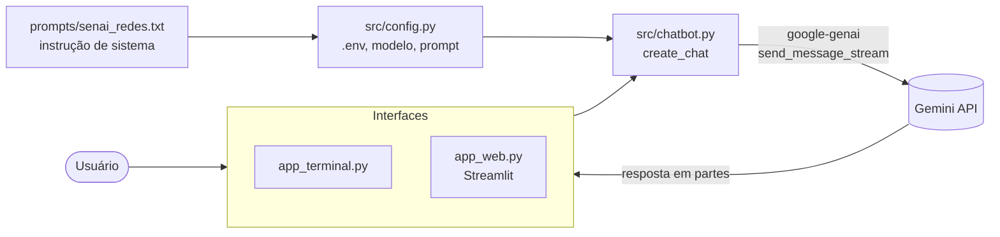
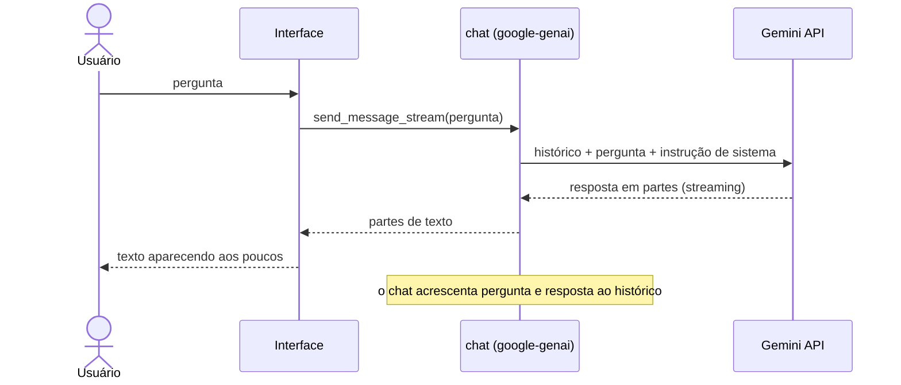

# Arquitetura

Este documento descreve como o projeto funciona hoje, com base no código do repositório.

## Visão geral

O projeto tem três camadas:

| Camada | Arquivos | Responsabilidade |
|---|---|---|
| Interface | `app_terminal.py`, `app_web.py` | Receber a pergunta, mostrar a resposta em streaming e tratar erros de exibição |
| Lógica do chatbot | `src/chatbot.py` | Criar o cliente da Gemini API e a conversa (`chat`) com a instrução de sistema |
| Configuração | `src/config.py`, `prompts/senai_redes.txt`, `.env` | Ler a chave e o modelo, carregar o prompt e explicar erros de configuração |

## Fluxo de uma pergunta

## Componentes

### `src/config.py`

- Carrega o arquivo `.env` da raiz do projeto com `python-dotenv`.
- Define `MODEL` a partir de `GEMINI_MODEL` (padrão `gemini-3.5-flash`).
- `get_api_key()` devolve a chave ou levanta `RuntimeError` com um diagnóstico da causa provável.
- `load_prompt()` lê o prompt de sistema da pasta `prompts/`.

### `src/chatbot.py`

- `create_client()` cria o cliente da API uma única vez e o guarda no nível do módulo.
- `create_chat()` cria a conversa com `system_instruction` carregada do prompt.

### `app_terminal.py`

Loop de entrada e saída: lê a pergunta, chama `chat.send_message_stream()` e imprime cada parte recebida. Erros da API são mostrados sem encerrar o programa.

### `app_web.py`

Interface Streamlit. O objeto `chat` e a lista de mensagens ficam em `st.session_state`, porque o Streamlit executa o script inteiro a cada interação. O botão "Nova conversa" recria os dois.

## Memória da conversa

A Gemini API não guarda a conversa. O objeto `chat` do SDK mantém o histórico na memória do programa e o envia junto com cada nova pergunta. Consequências:

- o histórico some quando o programa é encerrado ou a página é recarregada;
- conversas longas geram requisições maiores.

## Decisões de projeto

- **Prompt em arquivo.** O comportamento do chatbot muda editando um texto, sem alterar código.
- **Interfaces separadas da lógica.** Terminal e web usam o mesmo `create_chat()`.
- **Cliente em nível de módulo.** Na primeira versão, o cliente era uma variável local de `create_chat()`. Ao terminar a função, o Python o descartava e o SDK fechava a conexão, e a primeira pergunta falhava com `Cannot send a request, as the client has been closed`. Guardar o cliente no módulo resolveu a causa.
- **Erros de configuração explicados.** A falta do `.env` é o problema mais comum de quem clona o projeto, então a mensagem diz o que procurar.

## O que não existe (ainda)

- Persistência de histórico.
- Consulta a documentos (RAG) ou à internet.
- Autenticação de usuários e limite de uso próprio.
- Testes automatizados da resposta do modelo e da interface.
