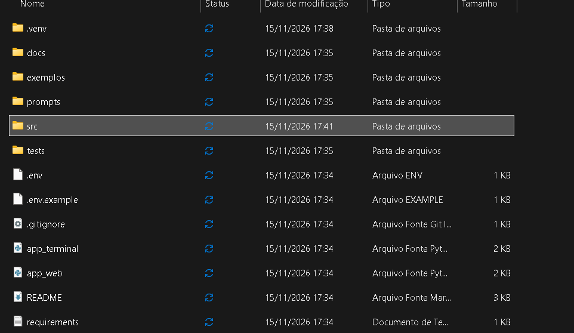
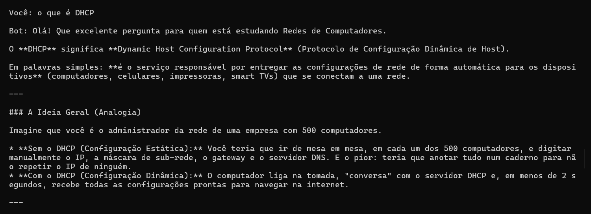
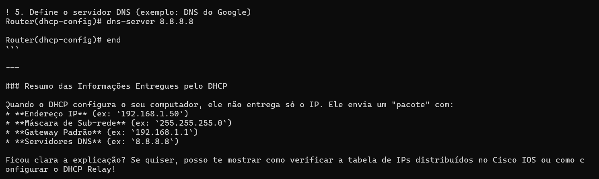

# Tutorial: como criar um chatbot com a Gemini API

Este tutorial acompanha os arquivos da pasta `exemplos/`. Cada passo adiciona uma ideia nova, e as capturas de tela são do projeto funcionando.

## Antes de começar

- Python 3.10 ou superior (`python --version`)
- Uma conta Google para gerar a chave da API
- Um editor, como o VS Code

> **Atenção:** muitos tutoriais antigos usam o pacote `google-generativeai` e o modelo `gemini-1.5-flash`. Os dois estão ultrapassados: o pacote atual é o **`google-genai`** e os modelos 1.5 foram aposentados (a API responde erro 404). Este projeto usa o SDK novo e o modelo `gemini-3.5-flash`. Se um dia o modelo mudar, troque apenas a variável `GEMINI_MODEL` no `.env`; a lista atual está em https://ai.google.dev/gemini-api/docs/models

## Etapa 0: preparar o ambiente

```bash
cd senai-networking-assistant      # ou o nome da sua pasta
python -m venv .venv
source .venv/bin/activate          # Windows: .venv\Scripts\activate
pip install -r requirements.txt
```

O ambiente virtual (`.venv`) isola as bibliotecas deste projeto das outras coisas do seu computador. Quando ele está ativo, o terminal mostra `(.venv)` no começo da linha.

## Etapa 1: obter e guardar a chave da API

1. Acesse https://aistudio.google.com/apikey e crie uma chave.
2. Crie o arquivo `.env` a partir do modelo:

   ```bash
   # Windows
   copy .env.example .env
   notepad .env
   # Linux/Mac
   cp .env.example .env
   ```

3. Troque `sua_chave_aqui` pela chave, sem aspas e sem espaços:

   ```
   GEMINI_API_KEY=cole_a_chave_aqui
   GEMINI_MODEL=gemini-3.5-flash
   ```

4. Confira a pasta. O `.env` fica **na raiz do projeto**, ao lado do `.env.example`, e não dentro de `src/`:

   

5. Nunca escreva a chave dentro do código e nunca suba o `.env` para o GitHub. O `.gitignore` já bloqueia isso. Se a chave vazar, apague-a no AI Studio e gere outra. Mais detalhes em [SECURITY.md](SECURITY.md).

Dicas para Windows:

- Se o Explorador não mostra o `.env`, ative Exibir > Mostrar > Extensões de nomes de arquivos, ou use `dir /a` no terminal.
- Ao salvar pelo Bloco de Notas, escolha "Todos os arquivos". Se escolher "Documentos de texto", o arquivo vira `.env.txt` e não é lido.
- Não crie o `.env` com `echo ... > .env` no PowerShell: ele salva em UTF-16 e o Python não consegue ler.

## Etapa 2: primeira pergunta (`exemplos/01_pergunta_simples.py`)

```python
client = genai.Client(api_key=os.getenv("GEMINI_API_KEY"))
resposta = client.models.generate_content(model=MODELO, contents="Explique DHCP")
print(resposta.text)
```

- `Client` é a ligação com a API.
- `generate_content` envia **uma** pergunta e devolve **uma** resposta.
- Não existe memória: cada chamada é independente.

Rode: `python exemplos/01_pergunta_simples.py`

## Etapa 3: memória (`exemplos/02_chat_com_memoria.py`)

```python
chat = client.chats.create(model=MODELO)
resposta = chat.send_message(pergunta)
```

O objeto `chat` guarda todas as mensagens anteriores e as reenvia a cada pergunta. Teste: diga "Meu nome é [seu nome]" e depois "Qual é o meu nome?". O bot deve responder com o nome que você informou.

Como funciona por baixo: a API não "lembra" de nada. Quem lembra é o seu programa, que manda o histórico inteiro toda vez. Por isso conversas muito longas ficam mais lentas e gastam mais cota, e por isso o histórico some quando você fecha o programa.

## Etapa 4: personalidade (`exemplos/03_personalidade.py`)

```python
config=types.GenerateContentConfig(system_instruction=PERSONALIDADE)
```

A `system_instruction` define quem o bot é, o que ele sabe e como responde. É a peça mais importante para um chatbot ficar com cara de produto. No projeto organizado, o texto fica em `prompts/senai_redes.txt`, então você ajusta o comportamento sem mexer no código.

Dicas para escrever um bom prompt de sistema:

- Diga o papel ("tutor de redes do SENAI").
- Diga o idioma e o nível de explicação.
- Diga o que fazer quando não souber ou quando a pergunta fugir do tema.
- Peça exemplos práticos e blocos de código.

Um limite importante: o prompt **orienta** o modelo, mas não o **obriga**. Em testes, o bot também respondeu perguntas fora de redes (gírias, memes), sempre tentando voltar ao tema. Se você precisar de uma restrição rígida, valide a pergunta no seu código antes de enviá-la.

## Etapa 5: streaming (`exemplos/04_streaming.py`)

```python
for pedaco in chat.send_message_stream(pergunta):
    print(pedaco.text or "", end="", flush=True)
```

Em vez de esperar a resposta inteira, você recebe pedaços e mostra conforme chegam. Fica bem mais agradável em respostas longas.

## Etapa 6: organizar em módulos (`src/`)

- `src/config.py`: lê o `.env`, define o modelo e carrega o prompt.
- `src/chatbot.py`: `create_chat()` monta o cliente, a personalidade e a memória.
- `app_terminal.py`: usa `create_chat()` no terminal.
- `app_web.py`: usa `create_chat()` na web.

Vantagem: terminal e web compartilham a mesma lógica. Se você mudar o modelo ou o prompt, os dois mudam juntos.

## Etapa 7: rodar o chatbot completo

No terminal:

```bash
python app_terminal.py
```

Depois do banner, digite uma pergunta e aperte Enter. Enter vazio é ignorado. Digite `sair` para encerrar. Exemplo real de resposta à pergunta "o que é DHCP":



O bot continuou com comandos de configuração do Cisco IOS e um resumo:



Repare que o terminal mostra as marcações de Markdown como texto (`**negrito**`, `###`). Isso é normal: o terminal não renderiza Markdown. A resposta muda a cada execução.

Na web:

```bash
streamlit run app_web.py
```

Conceitos principais do `app_web.py`:

- **O Streamlit reexecuta o arquivo inteiro a cada interação.** Por isso o histórico e o objeto `chat` ficam em `st.session_state`, que sobrevive entre as execuções.
- `st.chat_input` cria a caixa de mensagem; `st.chat_message` desenha os balões.
- `st.empty()` reserva um espaço que vai sendo atualizado durante o streaming.
- `st.markdown` renderiza as marcações de Markdown da resposta.
- O botão "Nova conversa" na barra lateral zera histórico e memória.

## Etapa 8: testes

```bash
python -m pytest
```

Os 9 testes não chamam a API (não gastam cota). Eles verificam que o prompt existe, que a chave é lida corretamente e que as mensagens de erro de configuração apontam a causa certa. Não há testes da resposta do modelo nem da interface web.

## Problemas comuns

| Sintoma | Causa provável | Solução |
|---|---|---|
| `Chave da API não encontrada` | `.env` ausente, no lugar errado ou com `sua_chave_aqui` | Leia a linha "Diagnóstico" da mensagem: ela diz o que falta. Crie o `.env` na raiz e cole a chave real |
| Chave colada no `.env.example` | Ele é só um modelo e não é lido | Copie para `.env` e cole a chave lá |
| Existe um `.env` dentro de `src/` | Cópia no lugar errado | Apague-o. O que vale é o `.env` da raiz, e uma cópia extra só duplica a chave |
| `Cannot send a request, as the client has been closed` | Versão antiga de `src/chatbot.py`, em que o cliente da API era descartado ao fim da função | Use a versão atual do arquivo, que mantém o cliente no nível do módulo |
| Erro 404 "model not found" | Modelo aposentado ou nome errado | Ajuste `GEMINI_MODEL` com um nome da lista oficial |
| Erro 400/403 de chave | Chave inválida ou revogada | Gere uma nova no AI Studio |
| Erro 429 | Limite de uso do plano gratuito | Espere um pouco e tente de novo |
| `ModuleNotFoundError: google` | Dependências não instaladas ou venv desativado | Ative o `.venv` e rode `pip install -r requirements.txt` |
| `ModuleNotFoundError: src` | Rodou o script de outra pasta | Rode sempre a partir da pasta raiz do projeto |
| Asteriscos e `###` no texto | O terminal não renderiza Markdown | Normal no terminal. Use a interface web para ver o texto formatado |

## Como subir no GitHub

```bash
git init
git add .
git status                      # confira: o .env NÃO pode aparecer na lista
git check-ignore -v .env        # deve mostrar a regra do .gitignore
git commit -m "Primeira versão do SENAI Networking Assistant"
git branch -M main
git remote add origin https://github.com/SEU_USUARIO/senai-networking-assistant.git
git push -u origin main
```

Se o `.env` aparecer em `git status`, **pare** e não faça o commit. Veja o checklist completo em [SECURITY.md](SECURITY.md).

## Próximos passos

1. **RAG com PDFs do SENAI:** extrair o texto dos PDFs, dividir em trechos, buscar os mais parecidos com a pergunta e enviá-los junto ao prompt.
2. **Vários modos:** um prompt para Cisco, outro para Linux, outro para Python, escolhidos na barra lateral.
3. **Deploy:** publicar no Streamlit Community Cloud guardando a chave em "Secrets" (não no repositório). Lembre que o app não tem login nem limite de uso.
4. **Currículo:** "Desenvolvi um assistente de estudos com Gemini API, Python e Streamlit para responder dúvidas de redes de computadores."
